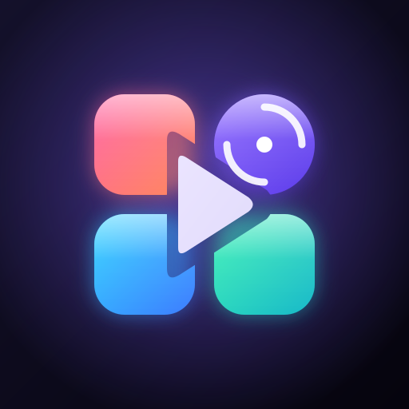

<p align="center"></p>

<h1 align="center">MediaGrid</h1>
<p align="center">A Windows ⇄ iPhone ecosystem: stream & sync music, browse PC media, back up iPhone photos, share a clipboard, browse PC files and control the PC from the phone.</p>

---

## Contents
1. [What it does](#1-what-it-does)
2. [How it works](#2-how-it-works)
3. [Repository layout](#3-repository-layout)
4. [Windows app (Tauri + Rust)](#4-windows-app-tauri--rust)
5. [iPhone app (SwiftUI)](#5-iphone-app-swiftui)
6. [HTTP / WebSocket API](#6-http--websocket-api)
7. [Building & installing](#7-building--installing)
8. [Developing — day to day](#8-developing--day-to-day)
9. [Recipes: adding a feature end to end](#9-recipes-adding-a-feature-end-to-end)
10. [Testing](#10-testing)
11. [Troubleshooting](#11-troubleshooting)
12. [Known limits & roadmap](#12-known-limits--roadmap)

---

## 1. What it does

| Area | Windows app | iPhone app |
|---|---|---|
| **Music** | Indexes your music folders (tags + embedded art), local player | Spotify-style home: Daily Mixes, On Repeat, Discover, Liked, Recently Added, albums, artists, playlists. Streams from the PC; **Sync** downloads for offline. Smart shuffle (no repeats, artists spread out). Lock screen, Control Center, **Dynamic Island / Live Activity**, AirPlay |
| **Media** | Grid of PC photos/videos + photos received from iPhone | Browse PC photos/videos by month, stream video with seeking, save to Photos, sync for offline |
| **Photo backup** | Saves iPhone photos to `Pictures\MediaGrid iPhone\YYYY-MM`, keeps capture date, toast summary | Auto-uploads new photos when the app is open + background task; skips what the PC already has |
| **Shared** | Universal clipboard watcher, history, drag-drop files to phone | Clipboard sync, send text/photos/files, history, QuickLook previews |
| **PC control** | Executes mouse/keyboard/media/power commands, serves screenshots | Multi-touch trackpad, keyboard, shortcut keys, media & volume, power, live screen with tap-to-click, full file explorer + upload |
| **Mobile** | See paired phones (battery, now playing), control phone playback, *Find iPhone*, request photo sync | Reports status, obeys PC commands |
| **System** | Tray app, starts with Windows, window close → tray, Bonjour advertising, firewall helper | Bonjour discovery, auto switch Wi-Fi ⇄ Tailscale address, Siri shortcuts |

## 2. How it works

```
┌──────────────── iPhone (SwiftUI) ────────────────┐            ┌──────────── Windows PC (Tauri) ────────────┐
│ Connection ── HTTP (REST, range streaming) ──────┼── LAN /  ──┼─▶ axum server :47800 (server.rs)            │
│            ── WebSocket /ws (events+control) ◀───┼─ Tailscale─┼── broadcast channel (state.rs)              │
│ NWBrowser  ◀── Bonjour _mediagrid._tcp ──────────┼────────────┼── mdns-sd advertiser                        │
│ Player / MusicStore / MediaStore / PhotoSync      │            │ Library scan (library.rs) · control.rs     │
│ ClipboardSync / Coordinator / LiveActivity        │            │ clip.rs watcher · notify folder watcher    │
└───────────────────────────────────────────────────┘            │ WebView UI (ui/*.html, *.js) via invoke()  │
                                                                  └────────────────────────────────────────────┘
```

* **The PC is the server.** The Rust backend runs inside the Tauri process (or alone with `--headless`), binds `0.0.0.0:47800`, and serves the API to the phone and to its own UI.
* **Auth:** you create an email + password in the PC app (Profile tab). The phone calls `POST /api/login`, gets a random token, stores it in the Keychain and sends it as `Authorization: Bearer …` or `?t=…` (the query form is needed for `AVPlayer` URLs).
* **Realtime:** one WebSocket per phone. PC → phone events (`clipboard`, `shared`, `library`, `command`, `signedout`), phone → PC messages (`status` and control commands).
* **No cloud.** Everything stays between your devices. Over the internet use Tailscale (the PC's `100.x` address).

## 3. Repository layout

```
mediagridv2/
├─ README.md                ← this file
├─ CLAUDE.md                ← instructions for Claude Code (conventions, commands, gotchas)
├─ .claude/commands/        ← Claude Code slash commands (/build-check, /run-server, /ship)
├─ .github/workflows/
│  └─ build.yml             ← CI: iOS unsigned IPA (macOS) + Windows installer, pushed to `builds` branch
├─ branding/                ← logo.svg, icon-1024.png, preview.png
├─ scripts/
│  ├─ dev-server.sh         ← run the PC backend headless with sample media (Linux/macOS/WSL)
│  └─ api-smoke.sh          ← curl smoke test of the main endpoints
├─ windows/                 ← PC app (Tauri 2)
│  ├─ package.json          ← only the Tauri CLI
│  ├─ ui/                   ← front-end: plain HTML/CSS/JS, no bundler
│  │  ├─ index.html         ← layout: title bar, sidebar, 6 tabs, player bar
│  │  ├─ app.css            ← glass design system (CSS variables at the top)
│  │  ├─ app.js             ← all UI logic (tabs, player, shared, media, mobile, profile, settings)
│  │  └─ logo.svg
│  └─ src-tauri/
│     ├─ Cargo.toml         ← Rust deps (axum, lofty, enigo, xcap, arboard, mdns-sd, notify, windows…)
│     ├─ tauri.conf.json    ← window, bundle (NSIS + MSI), identifier com.jeyaprakash.mediagrid
│     ├─ capabilities/      ← Tauri permissions granted to the UI
│     ├─ icons/
│     └─ src/
│        ├─ main.rs         ← entry → lib::run()
│        ├─ lib.rs          ← Tauri setup, tray, autostart, #[tauri::command]s, headless mode
│        ├─ config.rs       ← Config (JSON in %APPDATA%\MediaGrid), password hashing, ids
│        ├─ state.rs        ← App (shared state), events to UI/phones, rescan, folder watcher, toasts
│        ├─ library.rs      ← music/media scanning, tag cache, thumbnails (image crate + Windows Shell)
│        ├─ server.rs       ← every HTTP route + WebSocket
│        ├─ control.rs      ← mouse/keyboard/media/power (enigo) + screenshots (xcap)
│        └─ clip.rs         ← clipboard watcher (arboard)
└─ ios/                     ← iPhone app
   ├─ project.yml           ← XcodeGen spec (app + widget extension), iOS 26+, Info.plist keys
   ├─ MediaGrid/
   │  ├─ App/               ← MediaGridApp.swift (entry, scene phase, Siri shortcuts), RootView.swift (tabs)
   │  ├─ Core/              ← non-UI logic
   │  │  ├─ Connection.swift   ← REST + WebSocket client, login/Keychain, Bonjour, host failover
   │  │  ├─ Models.swift       ← Codable models mirroring the API
   │  │  ├─ MusicStore.swift   ← library cache, downloads, likes, play counts, playlists, smart mixes
   │  │  ├─ Player.swift       ← AVPlayer queue, smart shuffle, remote commands, Now Playing
   │  │  ├─ MediaStore.swift   ← PC media list, offline cache, save to Photos
   │  │  ├─ Services.swift     ← LiveActivityManager, PhotoSync, ClipboardSync, Coordinator (PC commands), SharedStore, Haptics
   │  │  └─ ImageCache.swift   ← memory+disk image cache, RemoteImage, ArtworkView
   │  ├─ UI/                ← SwiftUI screens (Theme, Onboarding, Music, Player, Media, Shared, PC, Profile)
   │  └─ Resources/Assets.xcassets
   ├─ Shared/ActivityShared.swift ← Live Activity attributes + intents (compiled into BOTH targets)
   └─ Widgets/MediaGridWidgets.swift ← Dynamic Island + Lock Screen UI
```

## 4. Windows app (Tauri + Rust)

### Startup sequence (`lib.rs::run`)
1. `App::new()` loads `%APPDATA%\MediaGrid\config.json` (creates defaults: Music, Pictures, Videos, `Downloads\MediaGrid`).
2. With `--headless` / `MEDIAGRID_HEADLESS=1`: runs only the server (no window/tray). Used for testing.
3. Otherwise builds Tauri with plugins *single-instance* (second launch focuses the window), *autostart* (`--minimized`), *dialog*, *notification*; creates the tray; spawns `server::run`, the clipboard watcher, the first rescan and the folder watcher; shows the window unless `--minimized`.
4. Closing the window hides it (`CloseRequested → prevent_close`); **Quit** is in the tray menu.

### Shared state (`state.rs`)
`App` is wrapped in `Arc` (`Shared`) and holds `cfg`, `lib`, `devices`, `shared` history, `synced` photo ids, the `events` broadcast channel and the UI token.
* `app.ui(event, json)` → desktop UI (`listen("mg")` in `app.js`).
* `app.push(json)` → every connected phone's WebSocket.
* `app.notify(title, body)` → Windows toast.
* `app.rescan()` → background scan; a request during a scan queues one more.

### Front-end ↔ backend
The UI is static files (`withGlobalTauri: true`, no bundler). It uses:
* `invoke("get_info" | "save_settings" | "set_account" | "rescan" | "revoke_device" | "reveal" | "open_folder" | "allow_firewall" | "plugin:dialog|open")` for local-only actions.
* The **same HTTP API as the phone**, at `http://127.0.0.1:<port>` with the per-run `uiToken` from `get_info`. So anything the UI can show, the phone can too.

### Data on disk
| What | Where |
|---|---|
| Config, account hash, tokens | `%APPDATA%\MediaGrid\config.json` |
| Synced photo ids / shared history | `%APPDATA%\MediaGrid\synced.json`, `shared.json` |
| Album art, thumbnails, tag cache | `%LOCALAPPDATA%\MediaGrid\{art,thumbs,tags.json}` |
| iPhone photos | `Pictures\MediaGrid iPhone\YYYY-MM\` (configurable) |
| Files sent from iPhone | `Downloads\MediaGrid\` (configurable) |

## 5. iPhone app (SwiftUI)

* **Target:** iOS 26+ (Liquid Glass: `glassEffect`, `GlassEffectContainer`, `.buttonStyle(.glass/.glassProminent)`, `Tab` API, `tabBarMinimizeBehavior`, `tabViewBottomAccessory` for the mini player). Swift language mode **5** (strict concurrency off).
* **State:** singletons that are `@MainActor ObservableObject`s, injected as `@EnvironmentObject` in `MediaGridApp`: `Connection`, `MusicStore`, `Player`, `MediaStore`, `PhotoSync`, `ClipboardSync`, `Coordinator`, `SharedStore`.
* **Tabs:** Music · Media · Shared · PC · Profile (`RootView.swift`). The mini player lives in the tab bar accessory; tapping opens `NowPlayingView` as a sheet.
* **Playback:** `Player` uses one `AVPlayer`; the queue is `queue` + `order` (index permutation) + `pos`. Local file if downloaded, else `/api/music/stream/{id}?t=…`. Plays are counted after 30 s / half the song.
* **Background:** `UIBackgroundModes = audio, fetch, processing`; `BGProcessingTask` `com.jeyaprakash.mediagrid.photosync`; photo library observer triggers sync while running.
* **Live Activity:** `LiveActivityManager` (app) ↔ `MediaGridActivity` (Shared) ↔ `MediaGridLiveActivity` (widget). Buttons use `LiveActivityIntent`s that call `IntentBridge.handler`, which the `Player` sets.
* **Storage:** downloads in `Documents/Music` and `Documents/Media` (excluded from iCloud backup); caches in `Caches/img`; state JSON in `Documents`.

## 6. HTTP / WebSocket API

Base: `http://<pc>:47800`. All routes except `/api/ping` and `/api/login` need the token.

| Method & path | Purpose |
|---|---|
| `GET /api/ping` | `{app, name, version, account}` — discovery/health |
| `POST /api/login` `{email,password,device}` | → `{token, name}` |
| `GET /api/me` | PC name, counts, toggles |
| `GET /api/music/tracks` | all tracks (`id,title,artist,album,duration,size,ext,added,track,year,has_art`, plus `bpm,energy,punch` once the PC's audio analysis has reached the song; `?pop=1` also adds `rank` (Deezer popularity, looked up in the background and stored in `popularity.json`); duplicates of one song are collapsed to the best quality) |
| `GET /api/music/stream/{id}` | audio, supports `Range` |
| `GET /api/music/art/{id}` | embedded cover |
| `POST /api/rescan` | rescan library |
| `POST /api/music/upload?name=…[&rescan=0]` | body = audio file; saved to `<music folder>/From iPhone`, then rescanned |
| `GET /api/media/items?kind=photo\|video` | PC media list |
| `GET /api/media/file/{id}` / `thumb/{id}?s=360` | original (Range) / JPEG thumbnail |
| `GET /api/files/list?path=&hidden=0` | explorer (`path` empty → places & drives) |
| `GET /api/files/raw?path=&download=1` / `thumb?path=` / `POST upload?dir=&name=` | file access |
| `GET/POST /api/clipboard` | read / set PC clipboard |
| `GET /api/shared`, `POST /api/shared/text`, `POST /api/shared/file?name=`, `GET /api/shared/file/{id}` | shared history & transfers |
| `GET /api/photos/synced`, `POST /api/photos/upload?asset=&name=&created=` | photo backup |
| `POST /api/control` | same JSON as WS control messages |
| `GET /api/screen?w=1280&q=60` | JPEG screenshot |
| `GET/POST /api/playback` | shared now-playing + recently played `{recent:[{id,at,pos,device}], now}`; POST `{id,pos,playing,device}`; pushes `playback` event |
| `GET/POST /api/playlists` | user playlists `[{id,name,trackIDs}]` shared by all devices (last writer wins); pushes `playlists` event |
| `GET/POST /api/call` | phone call state `{state: ringing\|dialing\|active\|ended, direction}` → PC floating call bubble; GET returns `{current, log}` |
| `POST /api/clipboard/silent` | set PC clipboard without syncing (history copy) |
| `GET /api/devices`, `POST /api/phone` | paired phones; send command to phone |
| `GET /ws?t=` | WebSocket |

**Control messages** (`control.rs::Cmd`, tagged by `type`):
`move{dx,dy}` · `moveabs{x,y}` (0–1) · `click{button,double}` · `down/up{button}` · `scroll{dx,dy}` · `key{key:"ctrl+c"}` · `text{text}` · `media{action: playpause|next|prev|volup|voldown|mute}` · `power{action: lock|screenoff|sleep|restart|shutdown|signout}`.
Phone status: `{type:"status", model, battery, charging, nowPlaying:{title,artist,album,playing}}`.
PC → phone commands (inside `{event:"command", command:{…}}`): `{cmd:"player",action:toggle|next|prev|shuffle}`, `{cmd:"find"}`, `{cmd:"syncPhotos"}`, `{cmd:"clipboard",text}`.

## 7. Building & installing

### CI (no Mac needed)
Every push to `main` runs `.github/workflows/build.yml`:
* **ios** (macos-15, latest Xcode): `xcodegen generate` → unsigned `xcodebuild` → `MediaGrid.ipa`. Fails if the app binary is missing.
* **windows** (windows-latest): `npm install && npx tauri build` → `MediaGrid-Setup.exe` (NSIS, per-user) + `MediaGrid.msi`.
* **publish**: pushes both files + `STATUS.txt` to the **`builds`** branch.

Get them: `git clone --depth 1 -b builds https://github.com/JeyaprakashRajesh/mediagridv2 builds`
Compile errors: `gh run view --log-failed` (look for ` error: `).

### Install
* **Windows:** run `MediaGrid-Setup.exe` → Profile → create account → Settings → folders → Save. Click *Allow through firewall* if the phone can't connect.
* **iPhone:** Sideloadly → pick the IPA → your Apple ID → Start. On the phone: Settings → Privacy & Security → **Developer Mode** on; Settings → General → VPN & Device Management → trust your Apple ID. Free Apple ID ⇒ reinstall every 7 days (Sideloadly auto-refresh).

### Local builds
* **Windows (on Windows):** install Rust + Node 20+ + WebView2, then `cd windows && npm install && npx tauri dev` (hot reload of `ui/`, Rust rebuilds on save). `npx tauri build` for the installer.
* **Backend on Linux/macOS/WSL:** `cd windows/src-tauri && cargo build && MEDIAGRID_HEADLESS=1 ./target/debug/mediagrid` (Linux needs `libwebkit2gtk-4.1-dev libgtk-3-dev libxdo-dev libayatana-appindicator3-dev` to compile).
* **iOS (needs a Mac):** `brew install xcodegen && cd ios && xcodegen generate && open MediaGrid.xcodeproj`.

## 8. Developing — day to day

1. Branch or work on `main`; keep commits small.
2. PC change → `cargo build` (and `cargo check`) in `windows/src-tauri`; test with `scripts/dev-server.sh` + `scripts/api-smoke.sh`.
3. UI change → edit `windows/ui/*`; `node -e "new Function(require('fs').readFileSync('windows/ui/app.js','utf8'))"` catches syntax errors; `npx tauri dev` on Windows to see it.
4. iOS change → push and watch CI (no Mac locally). Read errors, fix, push again.
5. When CI is green, pull the `builds` branch and install.

### Conventions
* **Rust:** small modules, no `unwrap()` on I/O in request paths, never hold a `parking_lot` guard across `.await` (axum handlers must be `Send` — copy values out in a block first). Windows-only code behind `#[cfg(target_os = "windows")]` with a non-Windows stub so it still builds on Linux.
* **API:** add fields, don't rename them (old phone builds keep working). JSON keys are `snake_case` for models, `camelCase` for UI-only `get_info`.
* **Swift:** keep logic in `Core/`, views in `UI/`; `@MainActor` stores; use `MainActor.assumeIsolated` in UIKit/AV callbacks; prefer system glass styles over custom blur; no third-party packages.
* **Design:** colors from `Theme` (Swift) / CSS variables in `app.css` (pink `#FF5FA2`, violet `#8F6BFF`, cyan `#2FD4FF`, mint `#3CF2B5`, ink `#0B0A16`).

## 9. Recipes: adding a feature end to end

**Example: “eject USB drive from the phone”.**
1. **Server** — add a variant to `control::Cmd` (`Eject { drive: String }`) and handle it in the worker thread (Windows command behind `cfg`). Nothing else: `/api/control` and the WebSocket already deserialize `Cmd`.
2. **iPhone** — in `UI/PCView.swift` add a button calling `conn.send(["type": "eject", "drive": "E:"])`.
3. **Desktop UI** (optional) — add to `app.js`.
4. Test: `curl -XPOST -H "Authorization: Bearer $T" -d '{"type":"eject","drive":"E:"}' -H 'content-type: application/json' localhost:47800/api/control`.

**New REST data (e.g. playlists stored on the PC):** add a handler in `server.rs`, register the route in `run()` under `secured`, add the model to `ios/MediaGrid/Core/Models.swift`, fetch with `Connection.shared.get("/api/…")`.

**New PC → phone push:** `app.push(json!({"event":"name", …}))` in Rust, handle the `name` in `Coordinator.handle` (`Services.swift`).

**New setting:** field in `Config` (with `#[serde(default)]` via the struct default), expose in `get_info`, accept in `save_settings`, add a control in `index.html` Settings + `renderSettings`/save in `app.js`.

## 10. Testing

```bash
scripts/dev-server.sh          # builds, creates /tmp/mghome with sample music/photos/video, account jp@test.com / secret123
scripts/api-smoke.sh           # logs in and exercises the main endpoints, prints PASS/FAIL
```
The desktop UI can be previewed in a normal browser by serving `windows/ui` and injecting a stub `window.__TAURI__` (see `scripts/dev-server.sh` comments). The iOS app is verified by CI compilation + on-device testing.

## 11. Troubleshooting

| Symptom | Fix |
|---|---|
| Phone: “Can't reach MediaGrid” | PC app running? Same Wi-Fi, or use the Tailscale `100.x` address. Click *Allow through firewall*. |
| “Create your account … first” | Set email/password in PC → Profile. |
| Status pill “port in use” | Another program uses 47800; change `port` in `config.json`. |
| Songs don't play on phone | Check the format: iOS can't play `ogg/opus/wma`; AAC/MP3/FLAC/ALAC/WAV are fine. |
| HEIC/video thumbnails blank on PC | Install “HEIF Image Extensions” from the Microsoft Store (Windows Shell thumbnails). |
| IPA installs but crashes | Re-check the latest CI run is green; reinstall with Sideloadly; Developer Mode on. |
| CI iOS job green but IPA tiny | The workflow checks the binary exists — if this happens again, read `build.log` errors. |

## 12. Known limits & roadmap

* iOS can't read the clipboard in the background → phone→PC clipboard sends when the app is opened (or via *Paste*).
* An iPhone can't be remote-controlled; the PC can control MediaGrid's player, ring the phone and request a photo sync.
* Two iPhones that both report the name “iPhone” replace each other's pairing.
* Screen view is JPEG polling (~10–15 fps); a WebRTC/H.264 stream would be smoother.
* Ideas: per-device tokens with revocation UI on the phone, lyrics, gapless/crossfade, HLS transcoding for unsupported formats, Windows → phone notifications mirroring, TestFlight distribution to drop the 7-day re-sign.
